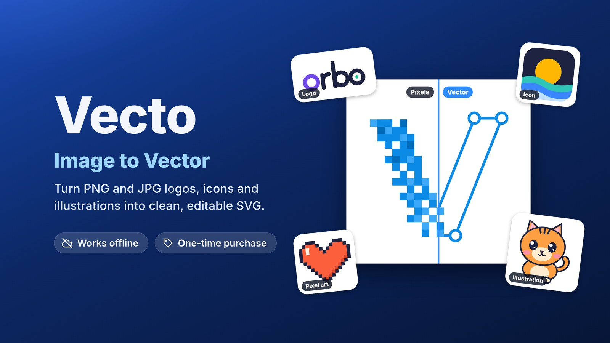

<p align="center">
  
</p>

<h1 align="center">Vecto</h1>

<p align="center"><b>Image to Vector</b></p>

<p align="center">
  Free and open source. Trace PNG and JPG images — logos, icons, illustrations, pixel art, scans — into clean, editable <b>SVG</b><br/>
  with mathematically exact circles, true straight lines, and zero gaps between shapes.
</p>

<p align="center">
  <a href="https://apps.microsoft.com/detail/9PM61P4NC8J2"></a>
  
  
  
  
</p>

<p align="center">
  <sub><a href="https://apps.microsoft.com/detail/9PM61P4NC8J2"><b>Get it on the Microsoft Store</b></a> for a one-click, auto-updating, signed install that supports development — or build the same open-source app free from the source below.</sub>
</p>


**Vecto** is a bitmap-to-vector tracing app (auto-tracer / image vectorizer) in the spirit of
Vector Magic and Adobe Illustrator's Image Trace — but free, open source, and built around one
structural idea: the traced image is a **planar partition**. Every boundary between two shapes
is fitted *once* and shared by both sides, so the output physically cannot contain the hairline
gaps and overlaps that plague most PNG-to-SVG converters.

## Why Vecto instead of other vectorizers?

- **No gaps, no overlaps — by construction.** Shared-boundary planar tracing (the same
  property Vector Magic's output has, and stacked-layer tracers like potrace don't).
- **Geometric intelligence.** Straight edges become true straight lines, circles and round
  caps become mathematically exact arcs (least-squares circle fits) — not wobbly
  approximations. Icons and logos come out looking *designed*, not traced.
- **Sub-pixel precision.** Anti-aliasing encodes where the real edge is; Vecto reads it and
  places boundaries at sub-pixel positions instead of snapping to the pixel grid.
- **Live side-by-side compare** with synced zoom/pan, segmentation view, palette swatches,
  and instant re-trace on every setting change. Copy the SVG straight to your clipboard.
- **Fast.** A 250 px logo traces in ~60 ms; a 4K photo posterizes in ~4.5 s.
- **Deterministic and tested.** Same input → byte-identical SVG; 14 geometric-invariant
  tests (exact area preservation, corner exactness, circle accuracy, culture safety).
- **Headless CLI + benchmark harness** for batch tracing and objective quality measurement.

## Best results — do's and don'ts

Vecto is built for **flat-color graphics**. Know what to feed it:

| Do | Don't |
|---|---|
| Logos, icons, badges, stickers, flags | Smooth gradients and soft shadows — they are traced as bands of color |
| Flat illustrations and cartoon art with clear outlines | Small text — letters can lose their shape; retype text in your vector editor |
| Clean line drawings and scans of line art | Small or low-resolution images (thumbnails, icons around 128 px) — fine detail is lost |
| The largest, sharpest version of the image you have (PNG, or a high-quality JPEG) | Photos and painterly art — they come out posterized, not photo-real |

## Install

### Option 1 — Download (recommended, no setup)

Grab the latest from the **[Releases page](https://github.com/DanielMevit/Vecto/releases)**:

- **`Vecto-x.y.z.exe`** — the desktop app as one self-contained file. Download, run, done —
  no .NET, no installer.
- **`Vecto-x.y.z-win-x64.zip`** — the app **plus the `vecto` command-line tool** (unzip
  anywhere; add the folder to `PATH` to use `vecto` from any terminal).

**CLI for Linux and macOS** (`vecto-x.y.z-linux-x64` / `-osx-x64` / `-osx-arm64`) is on the same page — full tracing, batch and benchmarking from any terminal (`chmod +x` after download).

SHA-256 checksums are listed in each release. Windows SmartScreen may warn on first run
(new, unsigned executable) — choose *More info → Run anyway*.

### Option 2 — Build from source

Requires Windows 10/11 and the free
[.NET 8 SDK](https://dotnet.microsoft.com/download/dotnet/8.0):

```bash
git clone https://github.com/DanielMevit/Vecto.git
cd Vecto
dotnet build -c Release
```

After the build:

- **Desktop app:** `Vecto.App\bin\Release\net8.0-windows\Vecto.exe` — run it directly or
  pin it to the taskbar.
- **CLI:** `Vecto.Cli\bin\Release\net8.0\vecto.exe` — add that folder to your `PATH` to
  call `vecto` from anywhere.

On **Linux or macOS**, use the ready-made `vecto` command-line downloads from the
[Releases page](https://github.com/DanielMevit/Vecto/releases) — the desktop app itself is Windows-only.

## Using Vecto

**App:** drop / paste (Ctrl+V) / open any PNG, JPG, BMP or GIF → automatic trace →
export or copy SVG. Transparency is preserved. Tip: feed the highest-resolution image you
have — trace quality scales with input size.

**CLI:**

```bash
vecto trace logo.png -o logo.svg --stats       # vectorize an image
vecto trace photo.jpg --style photo --colors 24
vecto trace scan.png --style lineart -o cad.dxf  # CAD linework (ASCII DXF R12)
vecto bench original.svg --scale 2             # round-trip quality benchmark vs ground truth
vecto samples out/                             # generate test images
```

**DXF export** (also in the app: *Export DXF…*) writes ASCII DXF R12 — the one dialect
virtually every CAD tool reads. Region outlines and holes become closed zero-width
polyline contours (R12 has no region fill — a hole is simply a second closed contour);
line-art strokes become polylines carrying the stroke width, with circular pieces as
vertex bulges and recovered full circles as CIRCLE entities where no width is attached.
Circular recovery checks the fitter’s endpoint, tangent and control construction,
recovering the intended analytic circle even when its cubic approximation differs
by more than 0.1 px at large radii. Other cubics use control-hull-bounded subdivision
and cleanup checked against all subdivision vertices (combined error ≤0.1 px).
Export fails explicitly if the bounded subdivision budget cannot meet tolerance.
Units are unitless: 1 image pixel = 1 drawing unit (`$INSUNITS` is written as 0 —
advisory metadata that strict R12 readers ignore; scale to mm/inch in your CAD tool).
Colours map to the nearest standard ACI pen on one layer per palette colour
(`VECTO_0`, `VECTO_1`, …), so traces toggle per colour. The complete conventional 255-colour palette
is searched by squared RGB distance, with ties going to the lower index; ACI 7
changes between black and white with the CAD background.

## How it works

Palette inference (weighted k-means++ in Oklab) → segmentation with small-region absorption
→ **planar boundary graph** (every chain between junctions traced once, shared by both
regions) → corner detection with sub-pixel validation → clamped smoothing + sub-pixel edge
refinement → simplest-model-first fitting (line → circular arc → least-squares Bezier) →
compact SVG. The full stage-by-stage map with parameters and code anchors lives in
[`docs/ai/ALGORITHM_INDEX.md`](docs/ai/ALGORITHM_INDEX.md).

Every algorithm is from the open literature (Schneider curve fitting, k-means++, Kåsa
circle fit, Oklab, Douglas–Peucker) — no license-encumbered code anywhere in the engine.

## Roadmap

Palette editor & tracing wizard, background removal, batch mode, PDF/EPS/DXF export,
segmentation editing tools, centerline (stroke) tracing. See [ROADMAP.md](ROADMAP.md).

## Contributing & docs

The repo is agent-friendly and human-friendly: start at [`AGENTS.md`](AGENTS.md) →
[`docs/ai/START_HERE.md`](docs/ai/START_HERE.md). Build must stay at 0 warnings; every
engine change should pass `vecto bench` before/after. PRs welcome — see [CONTRIBUTING.md](CONTRIBUTING.md). By contributing, you agree
that Daniel Mitev may relicense your contribution, including under commercial licences.

Brand (name, logo, app icon, colours): [docs/brand/BRAND.md](docs/brand/BRAND.md).

## License

From v0.4.4 on, Vecto is licensed under the [GNU AGPL-3.0-only](LICENSE) — © 2026 Daniel Mitev
(publicly Daniel Mevit, [@danielmevit](https://github.com/danielmevit)); see [NOTICE](NOTICE).
Versions up to and including v0.4.3 were released under the MIT License and stay MIT.

Want Vecto in a closed-source or commercial product without the AGPL obligations? Commercial
licences are available on request — contact Daniel Mevit (@danielmevit).

The Vecto name and logo belong to Daniel Mitev (Daniel Mevit); forks must use a different name
and logo.

Engine (`Vecto.Core`) has zero dependencies; the CLI uses SixLabors.ImageSharp 4.1.x for image
decoding (see [THIRD-PARTY-NOTICES.md](THIRD-PARTY-NOTICES.md)).

---

*Keywords: image to vector converter, PNG to SVG, JPG to SVG, vectorize logo, image
tracing software, auto trace, bitmap to vector graphics, free Vector Magic alternative,
Illustrator Image Trace alternative, potrace alternative with color, SVG converter
Windows, vectorizer C# .NET.*
