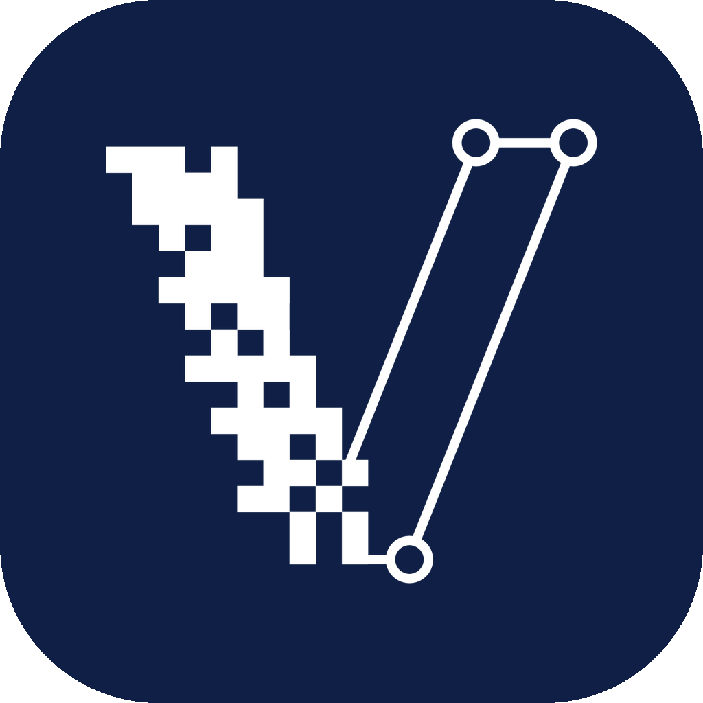
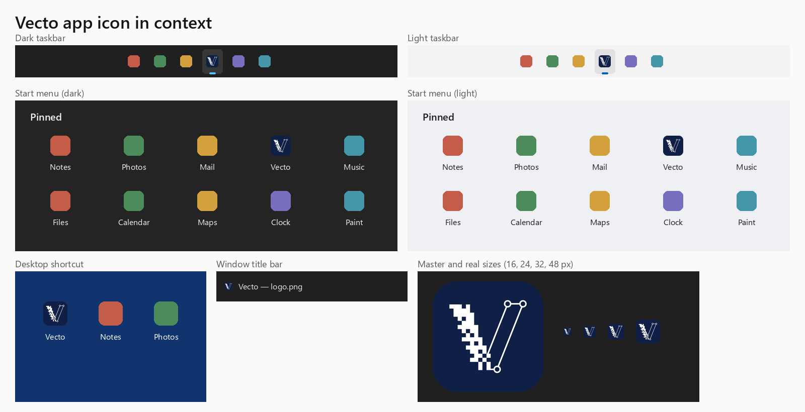
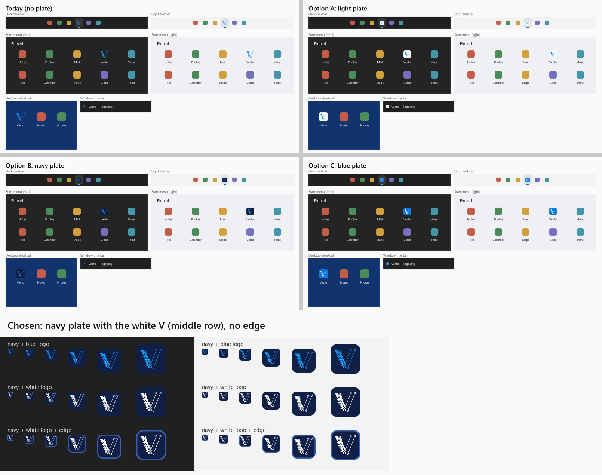
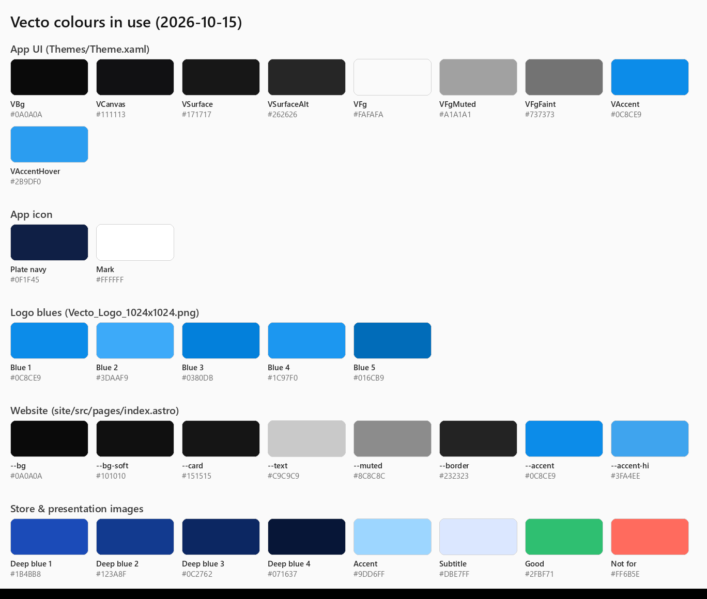

# Vecto — brand

The single place for Vecto's name, logo, app icon, colours and type. Last updated 2026-10-15.

## Name and voice
- **Vecto**, with the factual descriptor **"Image to Vector"** (Store name: "Vecto - Image to Vector").
- No slogans. Plain words a first-time user understands; say what it does and what it is not for.
- The name and logo belong to Daniel Mitev (publicly Daniel Mevit, @danielmevit). Forks must use a different name
  and logo (see NOTICE).

## Logo vs app icon
| | File | Use |
|---|---|---|
| **Brand logo** | `assets/Vecto_Logo_1024x1024.png` | The blue pixel "V" turning into a vector path, **transparent**. Artwork, README and Store images, the website header. |
| **App icon** | `assets/Vecto_Icon_1024x1024.png` (master), `assets/vecto.ico`, `assets/msix/*`, `site/public/favicon.ico`, `site/public/assets/vecto_icon_180.png` | The same "V" in **white on a solid navy rounded square**. Everywhere Windows or a browser shows the app: taskbar, Start menu, desktop, title bar, Store tile, browser tab, phone home screen. |

### App icon rules
- Plate: navy **#0F1F45**, rounded square, corner radius 22.5% of the side, edge to edge.
- Mark: the logo in **white (#FFFFFF)**, centred, 70% of the side (76% at 48–64 px, 82% at 16–32 px so it stays readable).
- No edge, no gradient, no shadow inside the icon.
- Regenerate every size from the master: `.ico` 16/24/32/48/64/128/256, msix Square44x44 / StoreLogo (50) /
  Square150x150, favicon (same sizes as the .ico), apple-touch icon 180.

### Why navy with a white V (decision 2026-10-15)
The old icon was the transparent logo, which got lost on dark taskbars. Four options were tried in real contexts —
today's icon, a light plate, a navy plate and a blue plate — then navy with a white mark. The white V on navy read
clearly at every size, on dark and light Windows themes, so the owner chose it.

Options explored (decision record):

## Colours in use

| Where | Tokens (source) |
|---|---|
| **App UI** | `Vecto.App/Themes/Theme.xaml`: VBg #0A0A0A, VCanvas #111113, VSurface #171717, VSurfaceAlt #262626, VSurfacePress #303030, VBorder white 10%, VBorderSoft white 5%, VFg #FAFAFA, VFgMuted #A1A1A1, VFgFaint #737373, **VAccent #0C8CE9**, VAccentHover #2B9DF0 |
| **App icon** | plate #0F1F45, mark #FFFFFF |
| **Logo** | blues #0C8CE9, #3DAAF9, #0380DB, #1C97F0, #016CB9 |
| **Website** | `site/src/pages/index.astro`: --bg #0A0A0A, --bg-soft #101010, --card #151515, --text #C9C9C9, --heading #FFFFFF, --muted #8C8C8C, --faint #6E6E6E, --border #232323, **--accent #0C8CE9**, --accent-hi #3FA4EE |
| **Store & presentation images** | deep-blue background #1B4BB8 → #123A8F → #0C2762 → #071637 (mostly the deep end), accent #9DD6FF, subtitle #DBE7FF, white pills (white at 14% with a 18% border), good #2FBF71, not-for #FF6B5E. Bright colours only in small amounts. |

The shared accent everywhere is **#0C8CE9**.

## Type
- **Inter** for the website, Store and presentation images.
- The app uses Inter where installed, then Segoe UI Variable, then Segoe UI (`MainWindow.xaml`); Consolas for the stats panel.

## Store and README images
- Store set: `store-images/` next to the repo (slides.html + render.cjs, 3840×2160). README featured image and
  slideshow: `assets/readme/`.
- Show what Vecto does with real traces; label image kinds (Logo, Icon, Illustration, Pixel art); keep the honest
  "best results / not for" message (flat graphics yes; gradients, small text, small images, photos no).
